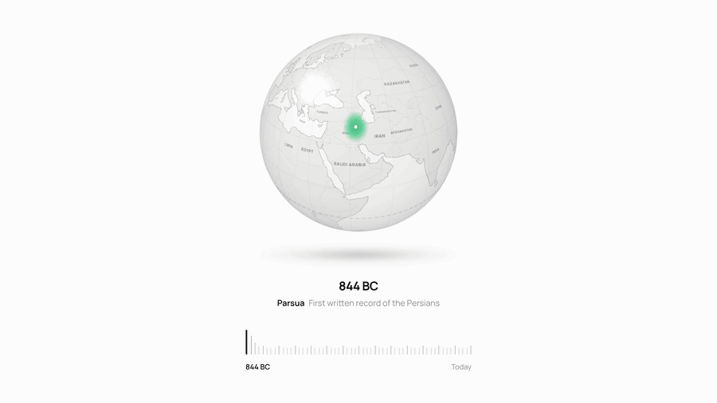
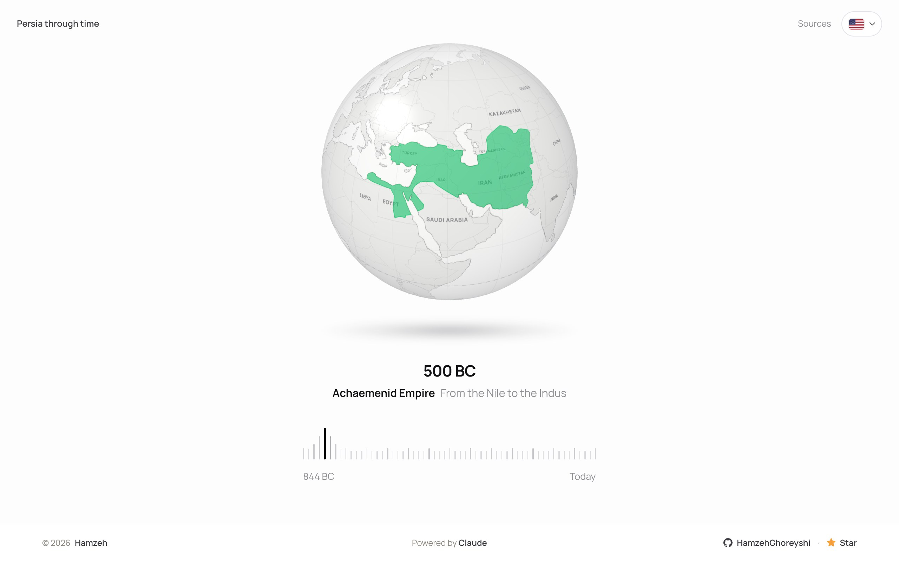
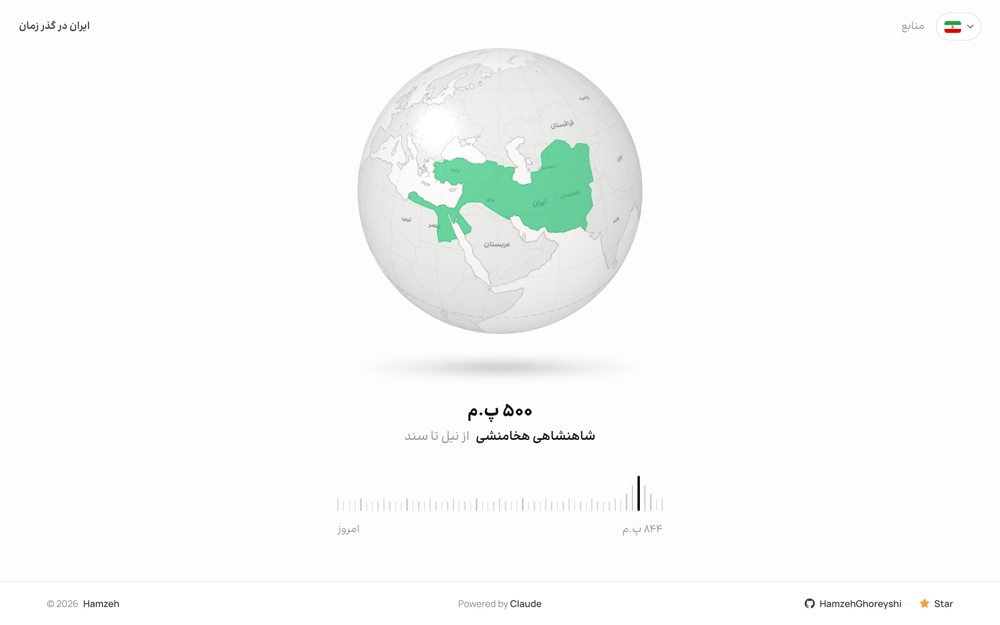

# ایران در گذر زمان

<p align="center">
  
</p>

**نمایش:** https://farid-madandar.github.io/iran-timeline · **ریپازیتوری:** https://github.com/Farid-Madandar/iran-timeline

یک گلوب تعاملی که نشان می‌دهد نقشهٔ ایران چگونه در ۲۸۰۰ سال گذشته تغییر کرده است، از نخستین ثبت نوشتاری پارسیان در ۸۴۴ ق.م تا ایران امروز. روی خط زعيم حرکت دهید، بکشید، یا از کلیدهای فلش استفاده کنید.





## How it works

- 15 stops. Each one is a snapshot of one real year in the border data; nothing is drawn by hand.
- The map underneath is always today's countries, very faint. Persia of each year is a see-through overlay on top, so you can read which modern countries it covered.
- The globe is one sphere drawn with plain WebGL 2 and one shader; the map is painted on 2D canvases. Between stops it makes a full spin with motion blur. No framework or 3D library: the first load is about 100 KB.
- Persian by default (right-to-left, Persian digits), English at `?lang=en`. `?stop=<id>` opens a given stop.

## Run

```bash
npm install
npm run dev
```

`npm run data` rebuilds `public/map.json` from the border files (downloaded into `tools/source-data/`).

## Record the video

`tools/record.mjs` films the timelapse frame by frame (60 fps, no dropped frames, no top bar or footer). It needs Google Chrome and ffmpeg.

```bash
npm run build
npm i --no-save puppeteer-core
node tools/record.mjs exports/portrait.mp4 540 675
```

The two numbers are the page size; the video is twice that (here 1080×1350). Add `fa` at the end for Persian.

## Credits

- Borders and coastlines: [historical-basemaps](https://github.com/aourednik/historical-basemaps) by André Ourednik, GPL-3.0. `public/map.json` is derived from it and carries the same licence. Shapes are approximate.
- Fonts: Manrope (SIL Open Font License); Ravi by Fontiran for Persian.
- Design and build: [Farid Madandar](https://github.com/Farid-Madandar) · [Telegram: @Farid_Madandar](https://t.me/Farid_Madandar)
